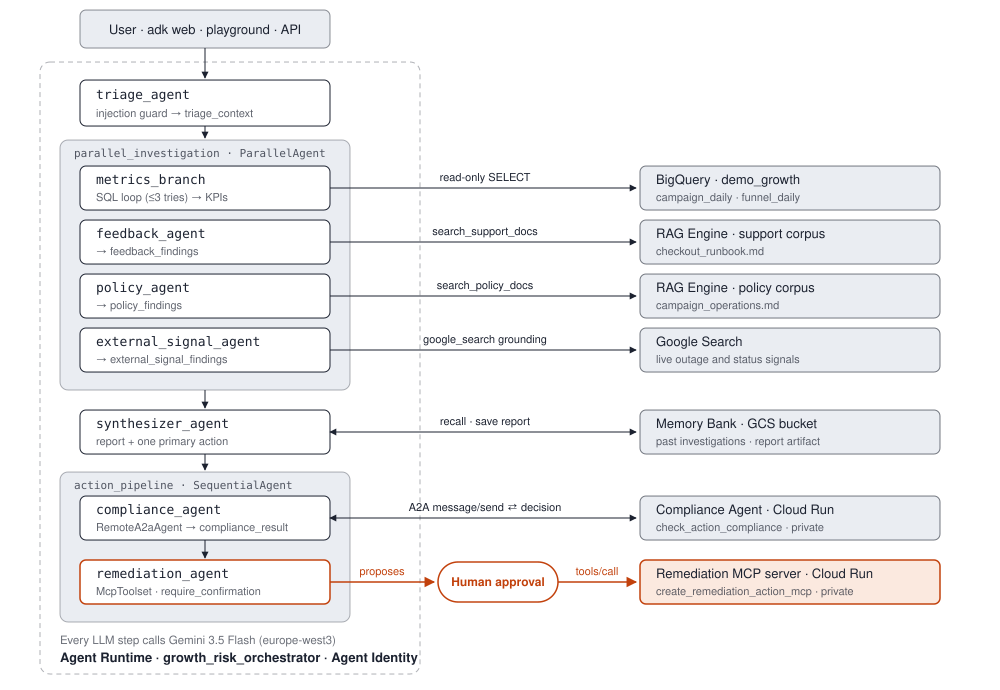

# Governed multi-agent system on Google Cloud

A working example of a multi-agent system built with the [Agent Development Kit (ADK)](https://adk.dev/) and
deployed with [`agents-cli`](https://github.com/google/agents-cli) and Terraform. It investigates why a marketing
campaign's conversions dropped, checks its proposed fix with a separate compliance agent, and only acts after a
human approves.

It is meant for learning: every step is in a notebook with the commands explained, and the
[design decisions](docs/design-decisions.md) and [lessons learned](docs/lessons-learned.md) record what went wrong
along the way and how it was fixed.



## What it shows

| Capability | Where |
|---|---|
| ADK workflow agents: sequential pipeline, parallel fan-out, a SQL retry loop | `growth-risk-agent/app/` |
| Tools as Python functions, callbacks as guardrails, structured output | `growth-risk-agent/app/tools/` |
| RAG with Vertex AI RAG Engine, as explicit function tools | `growth-risk-agent/app/tools/rag_tools.py` |
| An MCP tool server on private Cloud Run | `mcp-server/` |
| Agent-to-agent (A2A) calls to an independently deployed agent | `compliance-agent/` |
| Human-in-the-loop approval before the only write action | `growth-risk-agent/app/sub_agents/action_pipeline.py` |
| Memory Bank for cross-session recall | `growth-risk-agent/app/tools/memory_tools.py` |
| Agent Runtime with Agent Identity; Cloud Run with a service account | `*/deployment/terraform/` |
| Infrastructure as code with `agents-cli infra` and Terraform | `*/deployment/terraform/single-project/` |
| Observability: Cloud Trace, prompt logging, BigQuery Agent Analytics | notebook 06 |
| Evaluation: per-case rubrics, LLM judges, a deterministic safety metric | `growth-risk-agent/tests/eval/`, [docs](docs/evaluation.md) |
| Model Armor screening outside the model | `platform/terraform/model_armor.tf` |
| Agent Registry and publishing to Gemini Enterprise | notebooks 04 and 09 |
| A vendor's MCP server (HubSpot) with OAuth user sign-in, restricted to read-only | `examples/hubspot-mcp/`, notebook 10 |

## The example

A user asks: *"Investigate why campaign CAMP-2025-042 had a conversion drop on 2025-06-26."*

1. **Triage** turns the request into fields (campaign, date, issue type), asks a clarifying question if they are
   missing, and refuses prompt injection.
2. **A parallel investigation** queries BigQuery metrics (with a SQL retry loop), searches support runbooks and
   policy documents in RAG Engine, and checks Google Search for outages.
3. **A synthesizer** writes an evidence-based report ending in exactly one recommended action.
4. **The Compliance Agent**, a separate service called over A2A, checks that action against policy.
5. **If it is compliant**, the agent proposes a remediation ticket and **waits for a human to approve** before the
   MCP tool creates it.

### A second, standalone example: HubSpot over MCP

The MCP server above is one you run, called with a service identity. Most SaaS vendors now run their own MCP
servers instead, protected by OAuth, so an agent acts **as the signed-in user**.
[`examples/hubspot-mcp/`](examples/hubspot-mcp/) shows that with HubSpot's CRM: discovering the server's OAuth
settings, registering a client, keeping the secret in Secret Manager, connecting ADK's `McpToolset` with user
sign-in, and restricting the agent to read-only tools, objects and fields. The steps carry over to other
OAuth-protected MCP servers. It needs a HubSpot account, but nothing from the main demo; follow
[notebook 10](notebooks/10_hubspot_mcp.ipynb).

## Get started

### You need

- A Google Cloud project with billing enabled, where you have the **Owner** role. A new project is easiest to
  clean up afterwards.
- [`gcloud`](https://cloud.google.com/sdk/docs/install) (includes `bq`), [`uv`](https://docs.astral.sh/uv/),
  [Terraform](https://developer.hashicorp.com/terraform/install) 1.11+, and `agents-cli`:
  `uv tool install google-agents-cli`.

### Set up

```bash
git clone https://github.com/tchervenobrejki/ge-agent-platform-demo.git
cd ge-agent-platform-demo

gcloud auth login
gcloud auth application-default login
gcloud config set project YOUR_PROJECT_ID
```

### Follow the notebooks

Start Jupyter in the agent's Python environment, so the notebooks have every dependency:

```bash
cd growth-risk-agent && uv sync
uv run --with jupyterlab jupyter lab ../notebooks
```

(In VS Code, open a notebook and select `growth-risk-agent/.venv` as the kernel instead.)

The notebooks and setup scripts use your current gcloud project. If you switch between gcloud configurations,
`export PROJECT_ID=YOUR_PROJECT_ID` before starting Jupyter: it takes precedence.

| Notebook | You will |
|---|---|
| [00 Setup](notebooks/00_setup.ipynb) | create the data, document corpora, MCP server and caller identity the agents depend on |
| [01 Scaffold and code tour](notebooks/01_scaffold_and_code_tour.ipynb) | read how the agents are built |
| [02 Run locally](notebooks/02_run_locally.ipynb) | chat with the agent in `adk web` |
| [03 RAG and MCP](notebooks/03_rag_and_mcp.ipynb) | query the corpora; speak MCP to the tool server with `curl` |
| [04 Deploy](notebooks/04_deploy.ipynb) | deploy both agents with Terraform and `agents-cli`; call the Compliance Agent over A2A |
| [05 Use the deployed agent](notebooks/05_use_the_deployed_agent.ipynb) | approve an action; see Memory Bank recall |
| [06 Observability](notebooks/06_observability.ipynb) | follow one request across both services |
| [07 Evaluation](notebooks/07_evaluation.ipynb) | grade the agent |
| [08 Model Armor](notebooks/08_model_armor.ipynb) | screen prompts and responses |
| [09 Publish](notebooks/09_publish.ipynb) | register the agent with Gemini Enterprise |
| [10 HubSpot over MCP](notebooks/10_hubspot_mcp.ipynb) | optional, standalone: connect an agent to a vendor's MCP server as the signed-in user |
| [99 Cleanup](notebooks/99_cleanup.ipynb) | delete everything |

### Or use the command line

The notebooks wrap these commands:

```bash
./setup/01_project.sh && ./setup/02_bigquery.sh          # APIs, state bucket, caller SA; demo data
uv run setup/03_rag_corpora.py && ./setup/04_mcp_server.sh # RAG corpora; MCP server
uv run setup/05_write_config.py                          # fill in tfvars, backends and .env

P=YOUR_PROJECT_ID
cd compliance-agent
agents-cli infra single-project --project $P --apply
agents-cli deploy --project $P --region europe-west3 \
  --service-account compliance-agent-app@$P.iam.gserviceaccount.com \
  --memory 2Gi --cpu 1 --min-instances 0 --max-instances 3 --concurrency 4

cd ../growth-risk-agent
agents-cli infra single-project --project $P --apply
agents-cli deploy --project $P --region europe-west3 --agent-identity --update-only
```

See [setup/README.md](setup/README.md) for what each setup script does.

## Cost

Both agents scale to zero, and the data is tiny, so a run-through costs little: mostly Gemini calls, Cloud Build
and a few hours of idle telemetry storage. **One exception: RAG Engine's default Basic tier is billed for as long
as it is provisioned, even when idle.** Clean up when you are done ([notebook 99](notebooks/99_cleanup.ipynb)), or
delete the project.

## Repository layout

```
growth-risk-agent/   the orchestrator (ADK, Agent Runtime): app/, tests/, deployment/terraform/
compliance-agent/    the Compliance Agent (ADK, Cloud Run, A2A)
mcp-server/          the remediation MCP server (Cloud Run)
setup/               scripts that create what the agents depend on
data/                BigQuery seed data and the RAG documents
platform/terraform/  the Model Armor template (and an optional console-evaluation bucket)
examples/            standalone examples: hubspot-mcp/ (an agent that reads HubSpot over MCP)
notebooks/           the walkthrough; generated by build_notebooks.py
docs/                architecture, design decisions, lessons learned, evaluation, coding agents
.agents-cli-spec.md  the spec written before any code (agents-cli workflow, phase 0)
```

## Building with a coding agent

This project was built with an AI coding agent guided by Google's published **skills**, which work with any coding
agent (Claude Code, Antigravity, Gemini CLI, Codex, Cursor and others). Start with
[`google-agents-cli-onboarding`](https://github.com/google/skills/blob/main/skills/cloud/google-agents-cli-onboarding/SKILL.md);
the full list, with what each skill was used for, is in [docs/coding-agents.md](docs/coding-agents.md).

- Skills catalogue: <https://github.com/google/skills>
- agents-cli skills: <https://github.com/google/agents-cli/tree/main/skills>

## Documentation

- [Design decisions](docs/design-decisions.md): why it is built this way, and the log of every fix (F1–F30).
- [Lessons learned](docs/lessons-learned.md): short, reusable findings about ADK, agents-cli and the platform.
- [Evaluation](docs/evaluation.md): datasets, metrics, results, and the console's Agent Evaluation.
- [Coding agents](docs/coding-agents.md): the skills used to build this.

## Notes

This is a community learning example, not an official Google project or product. It is not a production system: the "ticketing system" behind the MCP server only returns a
ticket ID, and the data is synthetic. Versions move fast (this was built with agents-cli 1.10 and ADK 2.11 in
October 2026), so check current release notes before relying on version-specific details.

Licensed under the [Apache License 2.0](LICENSE).
